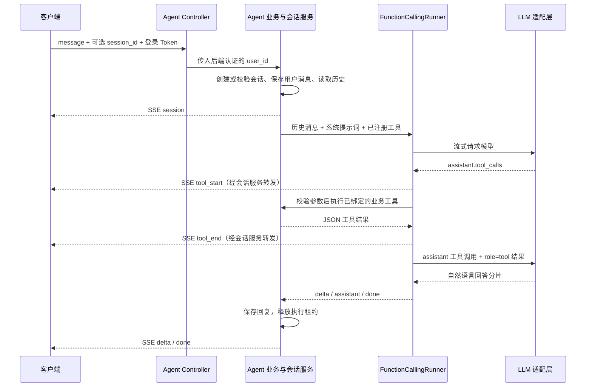

# Function Calling LLM / Agent 开发流程

[返回项目 README](../README.md)

本文以已实现的星座和商品 Agent 为例，说明接口、模型、工具和业务服务如何协作，以及后续新增 Agent 的开发步骤。两者共用原生 Function Calling、千问适配层和会话底座；商品 Agent 在工具内部增加 Chroma 语义召回与 MySQL 实时查询。当前未接入 LangChain / LangGraph，其他业务 Agent 可沿用这套分层扩展。

## 1. 分层与代码入口

```text
app/
├── agents/                  # Agent 定义和公共编排运行器
│   ├── llm/                 # 对话与 Embedding 适配、统一消息和流式分片协议
│   ├── astrology/           # 星座提示词、工具注册、运势内容生成
│   └── goods/               # 商品知识开场、只读工具注册、平台查询与推荐输出
├── services/
│   └── agent/               # Agent 业务、数据库操作、会话和消息管理
├── api/
│   └── controllers/         # Agent HTTP 入口
├── schemas/
│   └── agent/               # 接口参数、工具参数、生成内容和 SSE 事件校验
├── models/                  # 用户档案、会话、消息、运势缓存和商品表映射
├── setup/                   # 共享服务、商品索引的启动初始化与关闭
└── constants/               # 消息状态等业务常量

config/                      # AI、商品索引等后端业务配置
```

| 入口 | 职责 |
|------|------|
| [agent_controller.py](../app/api/controllers/agent_controller.py) | 定义接口、注入登录用户、返回档案 JSON 或 SSE 响应 |
| [AstrologyService](../app/services/agent/astrology_service.py) | 绑定当前用户的工具，查询和保存档案、读取和保存运势缓存 |
| [AgentChatService](../app/services/agent/chat_service.py) | 会话归属、历史上下文、执行租约、消息入库和异常收尾 |
| [星座 Agent 定义](../app/agents/astrology/agent.py) | 系统提示词、业务日期注入、工具声明和运行器创建 |
| [商品 Agent 定义](../app/agents/goods/agent.py) / [GoodsRunner](../app/agents/goods/runner.py) | 商品知识开场、工具注册、平台查询与推荐分阶段执行 |
| [GoodsService](../app/services/agent/goods_service.py) | 品牌解析、向量召回与实时查询衔接、内部索引维护 |
| [GoodsDataService](../app/services/agent/goods_data_service.py) / [GoodsVectorService](../app/services/agent/goods_vector_service.py) | 前者查询 MySQL 并组装商品；后者管理 Chroma 持久化、向量同步和召回 |
| [FunctionCallingRunner](../app/agents/runtime.py) | 拼接工具调用参数、校验、执行工具、多轮模型调用 |
| [运势内容生成](../app/agents/astrology/horoscope.py) | 缓存缺失时调用模型，生成并校验结构化娱乐内容 |
| [LLM 适配层](../app/agents/llm/base.py) | 用 `LLMAdapter`、`LLMMessage`、`LLMChunk` 隔离模型厂商 |
| [QwenLLM](../app/agents/llm/qwen.py) / [QwenAIService](../app/services/qwen_ai_service.py) | 前者将 SDK 分片转换为 `LLMChunk`，后者统一维护 `AsyncOpenAI` 请求、后端密钥、超时和错误处理 |
| [Embedding 适配层](../app/agents/llm/embedding.py) / [启动入口](../app/setup/agents.py) | 复用千问请求生成向量；应用启动时创建共享商品服务并后台初始化索引 |

Controller 只负责入口。Agent 层管理提示词和编排，Service 层处理身份、数据和业务规则；模型不能直接操作数据库。

## 2. 一次对话如何执行



Function Calling 的含义是：模型提出函数名称和 JSON 参数，后端执行已注册的函数，再把结果交回模型。模型自身不执行 Python 函数。

运行器按以下步骤处理：

1. 将系统提示词、有效历史消息和本轮问题发送给模型，同时提供 `AgentTool.schema()` 生成的工具定义。
2. 模型可以直接回答，也可以返回一个或多个 `tool_calls`。流式参数可能分散在多个分片中，运行器收齐后再解析，不能收到一个片段就执行。
3. 按工具名称查找已注册的 handler，用对应 Pydantic Schema 校验参数，再按超时限制执行。当前工具依次执行。
4. 保存带 `tool_calls` 的 `assistant` 消息，再保存 `role="tool"` 的工具结果；结果的 `tool_call_id` 必须对应原调用 ID。
5. 将工具结果加入上下文，再次调用模型。模型可以继续调用工具，或输出最终回答；达到工具轮数上限后，最后一轮只允许总结。

工具执行失败会返回结构化错误，并发出 `tool_end.success=false`，模型仍可据此解释失败或在限额内修正参数。整轮执行异常才通过 SSE `error` 结束。

## 3. 星座查询与运势缓存

### 服务范围

星座 Agent 只处理星座知识、性格、配对、运势、相关出生档案和星盘基础概念。“那感情呢”“明天呢”等承接星座上下文的追问也属于服务范围；正常问候可简短介绍功能。

天气、PHP / Go 编程等无关请求统一引导回星座咨询，不回答具体内容、不调用工具、不联网搜索。混合问题只回答星座相关部分，不能仅因无关问题中出现星座名称就放行。

这些规则维护在 `agents/astrology/agent.py` 的 `SYSTEM_PROMPT`，由模型遵循；当前没有独立的前置话题分类或硬拦截模块。

当前注册两个工具：

| 工具 | 模型可提交的参数 | 后端处理 |
|------|------------------|----------|
| `get_user_profile` | 无参数 | 读取当前登录用户的星座和出生档案 |
| `get_horoscope` | `constellation`、`fortune_date`、`aspect`，均可省略 | 查询指定星座、日期、领域的运势，无有效缓存时生成并保存 |

`constellation` 使用十二星座标准英文名，如 `pisces`；`aspect` 为 `all`、`love`、`career`、`wealth`。未指定星座时读取当前用户档案；档案也没有星座则请用户补充。未指定日期时，由后端按 `AGENT_TIMEZONE` 确定今天，每轮提示词也注入后端日期，避免模型猜测日期。

### 查询链路

```text
用户：双鱼座今天运势怎么样？
  → 编排模型识别意图，调用 get_horoscope
  → AstrologyService.get_horoscope
  → 按 星座 + 日期 + 领域 查询 MySQL horoscope_cache
      ├── 有效缓存：直接返回结构化内容
      └── 缺失或过期：
          释放读取事务 → generate_horoscope 调用模型生成 JSON
          → GeneratedHoroscope 校验 → 保存缓存 → 返回最终入库内容
  → 工具结果回给编排模型
  → 编排模型整理为自然语言，SSE 流式输出并保存聊天消息
```

这里有两种模型职责：**编排模型**负责理解问题、选择工具和解读结果；**内容生成模型**只在缓存缺失或过期时生成运势。两者目前都复用千问适配层，但调用相互独立。

生成阶段只传星座、日期、时区和领域，不传个人出生资料或聊天历史。内容必须包含五个非空字符串字段：`summary`、`love`、`career`、`wealth`、`advice`。生成不完整、字段非法或格式错误时，不写缓存。

### 缓存与来源约定

- 缓存是 MySQL 表 `horoscope_cache`，唯一键为 `constellation + fortune_date + aspect`。它与个人会话历史分开，同一星座、日期和领域可以跨用户复用。
- 当前生成内容标记 `source="ai_generated"`，附带“AI 生成的星座运势，仅供娱乐参考。”；`score` 保持空值。它属于 AI 创作，不代表第三方实时运势数据或专业星盘计算。
- 生成的缓存默认不设置 `expires_at`。日期变化会查询新的键；旧日期数据保留，不会在午夜自动删除。显式设置过期时间的记录会在查询时检查。
- 并发请求通过唯一键和写入规则保留有效结果，并重新读取最终入库内容；同时首次查询仍可能触发多次模型生成，目前没有合并生成请求的机制。
- 命中缓存会省略内容生成调用，编排模型仍需理解问题、调用工具并输出解读。

星座编排模型的 `AGENT_ENABLE_SEARCH` 允许使用千问搜索能力，但不会自动填充运势表。当前专用运势生成调用显式关闭搜索。后续接入第三方运势 API，可在 Service 中获取并校验数据，通过 `save_horoscope_cache` 保存真实来源，再继续复用现有工具和输出流程。商品 Agent 单独关闭联网搜索，商品事实以平台数据库为准。

提示词调整位置：星座身份、工具使用和回答规则在 `agents/astrology/agent.py`；生成运势的 JSON 格式与内容要求在 `agents/astrology/horoscope.py`。

## 4. 商品查询与向量索引

商品 Agent 只提供查询和推荐，复用现有用户、`chat_sessions`、`chat_messages`，会话标记为 `agent=goods`。没有商品新增、编辑或删除接口；内部向量同步方法也不提供给模型调用。

### 初始化与持久化

```text
应用启动 → app/setup/agents.py 创建共享 GoodsService
  → 后台 ensure_initialized
      ├── 本地存在完整且配置匹配的索引：直接复用
      └── 没有可复用索引：
          分批读取 MySQL 商品资料 → 千问 Embedding → 写入 Chroma
          → 全批次完成并校验后发布可查询的索引
```

使用 `chromadb.PersistentClient`，默认保存到 `./data/chroma_db`，Docker 已挂载该目录。商品向量首次批量保存，之后请求复用共享实例和持久化索引，**不会每次请求都从 MySQL 全量加载、重新向量化**。每次语义搜索仍需为本轮查询文本生成向量。重启只复用模型、维度、距离度量和文档版本匹配的完整索引。

向量文档包含商品名称、品牌、类目路径和描述，元数据保存商品、品牌、类目 ID；价格、库存和封面从 MySQL 实时读取。默认使用千问 `text-embedding-v4`、1024 维，复用已有 `QWEN_API_KEY` 和公共请求服务，不使用 Chroma 默认 Embedding 模型。

初始化失败不阻断其他 Agent，冷启动查询可能等待初始化并受工具超时约束。同一索引路径只运行一个应用进程；多 worker / 多副本不能共用这个本地目录。

### 工具与实时查询

| 工具 | 输入 | 后端处理 |
|------|------|----------|
| `tool_semantic_product_search` | `query`、可选 `brand` | 解析品牌 → 查询向量 → Chroma Top-K 与品牌过滤 → 按商品 ID 回查 MySQL |
| `tool_check_sku_stock_and_price` | `product_id` | 直接查询 MySQL 当前商品及 SKU，不经过向量召回 |

默认召回 10 个候选，按余弦距离阈值 `0.65` 过滤，再经 MySQL 核验后最多返回 3 个商品。距离越小越相似，阈值需要结合真实商品和问句校准。未知或歧义品牌会要求确认，不静默去掉品牌条件。

MySQL 过滤商品上架和 SKU 在售状态，组装品牌、类目、`cover_image`、规格、售价、库存与 `queried_at`。`spec_type=1` 为单规格、`2` 为多规格；价格来自 SKU，返回两位小数字符串。零库存规格保留并标记缺货，无在售 SKU 的商品不作为搜索推荐。

### 查询、结构化数据与文字输出

1. 先使用同一千问适配器进行无工具的简短开场，通过 `delta` 解释商品用途和相关选购要点。例如蓝牙耳机的连接方式、通勤用途以及降噪、续航等关注点。仅使用一般商品知识，不声称已联网或已查到平台商品。直接追问价格库存时，只简短提示将核实信息。
2. `GoodsRunner` 随后复用公共工具循环，查询决策阶段只公开 `tool_start` / `tool_end`，隐藏该阶段的自由文本和推理。
3. 全部工具决策结束后，收集本轮最终有效的 `ProductDTO`，发送一次 `data.kind=products` 结构化事件。查询阶段后续失败、下架或无匹配会作废先前事实，无有效商品时发送空列表。
4. 有商品时，再调用无工具的总结模型流式介绍平台商品，推荐说明目标约 300 字（通常 250～350 字），涵盖已有资料支持的推荐理由、适用场景和规格选择；资料不足或仅查询单项信息时允许简短回答。随后由后端固定追加本轮 SKU、售价、库存和查询时间，这部分不计入推荐字数；无商品时使用后端兜底答复。字数通过提示词约束，不截断流式正文。常见单工具查询包含开场、决策、决策终止和最终总结共 4 次模型请求，比原查询流程增加一次简短模型调用。
5. 共用 `AgentChatService` 保存开场、工具调用、工具结果及最终推荐回复，整轮完成后只发送一次 `done` 并释放租约。开场是独立助手消息；最终推荐与商品卡片关联另一个 `message_id`。任一阶段中断时保留已输出内容，旧商品事实不作为当前售价库存依据。

结构化商品事件由后端序列化查询结果产生，**封面地址无需模型生成，也不靠提示词约定返回**。它与开场和推荐文字属于同一次 HTTP/SSE 响应。开场不提供具体平台售价、库存或推荐清单；具体商品事实仍须经过本轮工具查询。

### 数据变动后的索引维护

当前没有自动轮询 MySQL 或变更捕获。内部调用 `GoodsService.refresh_index(product_ids)` 可同步指定商品，`rebuild_index()` 可完整重建；只维护向量，不修改商品表。

商品名称、描述、品牌、类目发生变化，或重新导入商品数据后，需要显式同步。品牌和类目变化应覆盖关联商品。价格、库存或 `cover_image` 变化无需重建向量，下次查询直接读取 MySQL。空库生成的完整空索引也会被复用，因此后续导入数据仍要触发同步。

后端检索参数见 [config/goods.py](../config/goods.py)，部署所需表结构及公共配置见下文“会话、数据与配置”。

## 5. 接口与 SSE 协议

以下接口均使用项目登录 Token，通过 `Authorization: Bearer <token>` 传递身份，不接受请求体中的 `user_id`。

### 星座档案

| 方法 | 路径 | 用途 |
|------|------|------|
| GET | `/api/agent/astrology/profile` | 查询当前用户档案，供前端回显 |
| POST | `/api/agent/astrology/profile` | 首次创建或更新当前用户档案 |

```bash
curl -sS 'http://127.0.0.1:8001/api/agent/astrology/profile' \
  -H 'Authorization: Bearer <token>'

curl -sS 'http://127.0.0.1:8001/api/agent/astrology/profile' \
  -H 'Authorization: Bearer <token>' \
  -H 'Content-Type: application/json' \
  -d '{"birthday":"2000-03-01","birth_time":"09:30:00","birth_timezone":"Asia/Shanghai","birth_place":"上海","constellation":"pisces"}'
```

可提交 `birthday`、`birth_time`、`birth_timezone`、`birth_place`、`birth_latitude`、`birth_longitude`、`constellation`，均为可选字段。省略字段保持原值，显式传 `null` 清空对应字段；星座使用标准英文名，不会仅根据生日自动计算。

接口使用统一的 `code`、`msg`、`data` JSON 响应。没有档案时，查询返回 `data={"found":false,"message":"尚未设置星座档案"}`；保存成功和已有档案的查询均返回 `data={"found":true,"profile":{...}}`。每个用户保留一份档案。

保存后，Agent 的 `get_user_profile` 工具可以读取档案，未指定星座的运势查询可使用其中的默认星座。聊天中提到某个星座不会自动写入个人档案，当前没有注册资料保存工具。

### 流式对话

两个流式接口共用请求结构和认证方式：

| 方法 | 路径 | 业务 |
|------|------|------|
| POST | `/api/agent/astrology/stream` | 星座咨询和运势查询 |
| POST | `/api/agent/goods/stream` | 商品语义搜索、规格及实时售价库存查询 |

| 请求字段 | 必填 | 说明 |
|----------|------|------|
| `message` | 是 | 1～4000 字符，不接受纯空白 |
| `session_id` | 否 | 已有会话 UUID；省略或传 `null` 创建新会话 |

请求不接受 `user_id`、模型、密钥或工具配置等额外字段。用户身份来自认证依赖，模型和工具由后端配置。每次省略 `session_id` 都会创建新会话，客户端需保存 `session` 事件返回的 ID 用于续聊。

新建星座对话：

```bash
curl -N -sS 'http://127.0.0.1:8001/api/agent/astrology/stream' \
  -H 'Authorization: Bearer <token>' \
  -H 'Content-Type: application/json' \
  -d '{"message":"帮我看看双鱼座今天的运势，包含感情、事业和财运。"}'
```

新建商品对话：

```bash
curl -N -sS 'http://127.0.0.1:8001/api/agent/goods/stream' \
  -H 'Authorization: Bearer <token>' \
  -H 'Content-Type: application/json' \
  -d '{"message":"帮我找适合出差使用的降噪耳机，列出规格、价格和库存。"}'
```

续聊使用原来的接口，将 `session_id` 替换为对应 `session` 事件返回的 UUID。例如星座续聊：

```json
{
  "message": "再详细说说事业方面。",
  "session_id": "11111111-1111-4111-8111-111111111111"
}
```

每个 SSE 数据块为 `data: {JSON}`，空行分隔；按 JSON 的 `type` 判断事件，不依赖命名 `event:`。

| `type` | 用途 |
|--------|------|
| `session` | 返回当前 `session_id` 和 `agent` 标识 |
| `tool_start` | 工具开始执行，包含 `tool_name`、`tool_call_id` |
| `tool_end` | 工具结束，包含调用标识和 `success` |
| `data` | 结构化业务数据；商品使用 `data.kind=products` 和 `data.products` 返回卡片内容 |
| `delta` | 回答文本片段，追加 `content`；`message_id` 标识对应消息 |
| `reasoning` | 协议预留的推理分片；当前千问 Agent 使用非思考模式 |
| `done` | 本轮正常结束，包含最终消息 ID 和编排运行器累计用量 |
| `error` | 流开始后的执行异常，`content` 为错误说明 |

以下为精简示例，ID 和内容仅用于说明：

```text
data: {"type":"session","session_id":"11111111-1111-4111-8111-111111111111","agent":"astrology"}

data: {"type":"tool_start","session_id":"11111111-1111-4111-8111-111111111111","agent":"astrology","tool_name":"get_horoscope","tool_call_id":"call_demo"}

data: {"type":"tool_end","session_id":"11111111-1111-4111-8111-111111111111","agent":"astrology","tool_name":"get_horoscope","tool_call_id":"call_demo","success":true}

data: {"type":"delta","session_id":"11111111-1111-4111-8111-111111111111","agent":"astrology","message_id":3,"content":"以下是双鱼座今日的生活参考，AI 生成，仅供娱乐参考。"}

data: {"type":"done","session_id":"11111111-1111-4111-8111-111111111111","agent":"astrology","message_id":3,"usage":{}}

```

星座知识问答可以不调用工具，工具也可能多轮调用，文本分片还可能出现在工具调用前。`tool_end.success=true` 表示函数执行成功，不等同于结果一定存在，例如档案查询可正常返回 `found=false`。工具结果不会全部原样公开；商品 Agent 显式筛选并校验商品数据，通过 `data` 事件返回给前端。

### 商品卡片事件与前端消费

商品流通常为：`session → delta（商品知识开场）→ tool_start / tool_end（可多轮）→ data → delta（平台推荐）→ done`。下面展示 `data` 事件的格式，商品和地址仅作示例：

```text
data: {"type":"data","session_id":"11111111-1111-4111-8111-111111111111","agent":"goods","message_id":30,"data":{"kind":"products","products":[{"product_id":9,"name":"降噪耳机","brand_id":15,"brand_name":"索尼","category_id":6,"category_name":"音频设备","cover_image":"https://example.com/headphones.jpg","description":"主动降噪，适合差旅。","spec_type":2,"availability":"in_stock","queried_at":"2026-11-12T18:30:00+08:00","skus":[{"sku_id":18,"sku_code":"SKU-XM5-BLK","spec_name":"黑色 / 标准版","price":"2299.00","stock":35}]}]}}

```

- 前端按 JSON 的 `type=data` 且 `data.kind=products` 识别商品数据，使用 `data.products` 渲染卡片。这里的 SSE `data:` 前缀、JSON 事件 `type` 和 JSON 内的 `data` 对象分别属于协议、事件类型和业务载荷。
- 封面字段为 `cover_image`，直接返回数据库值；为空时返回 `""`，由前端显示占位图。不会自动拼装不存在的图片地址。
- 收到最初的 `delta` 即可展示商品知识开场，卡片展示后保持连接继续接收推荐文字，`done` 才表示本轮正常结束。开场与最终推荐是两条助手消息；按 `message_id` 分别关联，或在同一轮回答中依次展示。`data.message_id` 与最终推荐及 `done` 一致。`data` 不会另存为一条聊天文本，原始商品工具结果仍保存在消息表。
- `products: []` 表示本轮没有有效商品；复用推荐区时应清空该区域，避免把上一轮商品误作本轮结果。
- 发送商品数据后，文字生成仍可能失败；收到 `error` 即按失败结束，不等待必有的 `done`。

`done.usage` 当前统计编排运行器各轮模型调用的整数用量字段，商品会合并开场、决策和总结阶段用量；不包含 Embedding 请求或工具内部独立生成运势的模型用量，不能直接作为整条链路的计费总量。

输入、认证、会话归属和会话占用等在首个事件前校验，失败沿用项目 JSON 错误响应；流开始后的异常使用 `error` 事件，此时不能再切换 HTTP 响应格式。客户端收到 `error` 后按失败结束，不要求后面一定有 `done`。

## 6. 会话、数据与配置

### 数据表

| 表 | 用途 |
|----|------|
| `users` | 复用现有用户，`id` 为整数，不另建 UUID 用户体系 |
| `user_astrology_profiles` | 每个用户一份星座和出生档案 |
| `chat_sessions` | UUID 会话，按 `user_id + agent` 校验归属，记录执行租约 |
| `chat_messages` | 保存用户、助手和工具消息，以及工具调用与结果关联 |
| `horoscope_cache` | 公共日运内容、来源及可选过期时间 |
| `goods_categories` / `goods_brands` | 商品类目与品牌，供查询和索引资料组装 |
| `goods_products` / `goods_skus` | SPU 商品资料与 SKU 规格、售价、库存 |

`ChatMessageStatus` 定义在 [app/constants/astrology.py](../app/constants/astrology.py)：`0` 生成中、`1` 已完成、`2` 失败、`3` 中断。这是聊天消息状态，与图片和视频作品状态分开使用。

同一个会话同时只允许一个有效执行租约。进程异常导致租约过期后，新请求可恢复会话，并将遗留生成中消息标记为中断。历史重放保留有效工具调用组合并按配置裁剪；异常或断开连接时尝试保存已收到的部分文本并释放执行资源。数据库操作使用短事务，不在等待模型或工具网络请求时持有数据库事务。

部署前执行 `alembic upgrade head`。相关迁移包括 `20261111_0002` 的星座与会话四表、`20261111_0003` 的会话执行字段，以及 `20261112_0001` 的商品四表。商品迁移仅补建缺失表，不导入示例商品；已有表保留。当前已开放星座、商品流式对话及星座档案读写接口，缓存和商品索引维护仍通过内部 Service 方法执行。

### 后端配置

默认值维护在 [config/ai.py](../config/ai.py)，统一通过 `app.core.config.settings` 使用；密钥等环境信息在本地 `.env` 中维护，不传给前端。

| 配置 | 默认值 | 用途 |
|------|--------|------|
| `AGENT_LLM_PROVIDER` | `qwen` | 模型厂商适配器 |
| `AGENT_MODEL` | `qwen-plus` | 公共 Agent 默认模型，星座使用此配置 |
| `GOODS_AGENT_MODEL` | `qwen-flash` | 商品知识开场、工具决策和推荐总结使用的模型 |
| `AGENT_ENABLE_SEARCH` | `True` | 星座编排模型的千问联网搜索开关，商品 Agent 显式关闭 |
| `AGENT_TIMEZONE` | `Asia/Shanghai` | 当前业务日期 |
| `AGENT_MAX_TOOL_ROUNDS` | `4` | 最大工具调用轮数，其后仅总结 |
| `AGENT_MAX_TOOL_CALLS` | `4` | 每轮工具调用数量限制 |
| `AGENT_MAX_HISTORY_MESSAGES` | `60` | 历史读取消息数量上限 |
| `AGENT_MAX_HISTORY_CHARS` | `24000` | 历史上下文字数上限 |
| `AGENT_TOOL_TIMEOUT` | `30.0` 秒 | 单次工具执行及运势生成超时 |
| `AGENT_RUN_TIMEOUT` | `300.0` 秒 | 整轮执行超时 |

Agent 复用已有 `QWEN_API_KEY` 和 `QWEN_CHAT_URL`，鉴权、请求发送及错误处理集中在 `QwenAIService`。普通对话和所有 Agent 统一通过 `AsyncOpenAI` 接收上游分片，不再手动拆解 SSE；`QwenLLM` 只转换正文、思考、工具参数片段、结束原因和用量，工具参数组装及执行仍由 `FunctionCallingRunner` 负责。

`QWEN_CHAT_URL` 继续填写完整的 `/chat/completions` 地址，由公共服务派生 SDK 的 `base_url`。SDK 请求关闭自动重试，保持原有调用策略；取消或断开时关闭响应及客户端。多模态接口通过同一 SDK 的原始流式响应转发字节，保留音频、用量和结束标记。原生 TTS、图片、视频和商品 Embedding 保持已有调用方式，各接口对前端的协议不变。

商品 Embedding 模型、维度和地址也维护在 `config/ai.py`；商品 Agent 模型、功能开关、持久化路径、集合名称、索引批量大小、Top-K、距离阈值及返回数量在 [config/goods.py](../config/goods.py) 统一维护。模型工厂支持按业务指定模型，商品三个阶段共用同一适配器。仅切换商品对话模型无需重建向量索引。密钥继续从后端读取，前端只提交业务请求。

## 7. 新增工具或 Agent 的开发步骤

### 给现有 Agent 增加工具

1. 在 `app/schemas/agent/` 定义参数 Schema，使用 `extra="forbid"` 和字段约束。参数只描述业务输入，用户身份从后端认证上下文取得。
2. 在 `app/services/agent/` 实现业务方法，负责归属检查、查询、业务规则和结构化返回值；新增表时补充 Model、导出注册和 Alembic 迁移。
3. 创建 handler：个人数据工具参考 `AstrologyService._chat_service` 绑定当前 `user_id`；公共商品工具复用 `GoodsService`，会话归属仍由公共聊天服务校验。通过会话工厂取得工具自己的短数据库会话，避免在远程请求期间占用查询事务。
4. 在 Agent 工厂的 `tools` 中增加 `AgentTool(name, description, parameters, handler)`，并在系统提示词中说明调用条件与结果解释规则。
5. 复用 `FunctionCallingRunner` 的参数校验、超时、错误结果、消息关联和 SSE 转换，无需为每个工具另写模型 HTTP 请求。

现有运势工具的注册方式：

```python
AgentTool(
    name="get_horoscope",
    description="获取指定星座、日期、领域的运势；优先读缓存，无缓存时生成 AI 娱乐参考。",
    parameters=HoroscopeToolRequest,
    handler=horoscope_handler,
)
```

其中 `horoscope_handler` 由业务 Service 绑定真实用户，运行器只向它传递通过 Schema 校验的业务参数。工具结果应是可 JSON 序列化的数据，日期、Decimal 等由 Service 转为适合返回的类型。

### 新增一个业务 Agent

1. 在 `app/agents/<业务名>/` 新建定义，维护该 Agent 的提示词和工具集合，为运行器设置独立 `name`。
2. 在 `app/services/agent/` 新建业务服务，绑定该业务的工具，复用 `AgentChatService` 管理会话和消息。
3. 在 `app/api/controllers/agent_controller.py` 增加对应路由，继续只做参数、身份和响应转发。例如未来可增加 `/api/agent/divination/stream`，当前尚未实现。
4. 请求兼容时继续使用 `AgentChatRequest` 和 `AgentStreamEvent`；新增业务参数放到该 Agent 的 Schema 中校验。会话必须继续按用户和 Agent 标识隔离。
5. 如需向量库等共享资源，参考 `app/setup/agents.py` 接入应用启动和关闭生命周期，避免每次请求重复创建客户端或全量索引。
6. 如需商品卡片一类结构化结果，参考 `GoodsRunner` 输出 `AgentStep("data", data={...})`，由公共会话服务转成现有 SSE 事件。载荷必须来自后端校验后的业务数据，不能依赖模型自由拼装；保持与文字消息的 ID 关联。
7. 验证新建与续聊、工具参数错误、缓存命中与缺失、跨用户 / 跨 Agent 访问、并发执行和客户端断开等实际场景。结构化输出还需检查事件顺序、空结果、封面空值、实时价格和后续工具失败后的事实失效。

### 新增模型厂商或替换编排框架

新增厂商在 `app/agents/llm/` 实现 `LLMAdapter.stream(messages, tools)`，输出统一的 `LLMChunk`，再更新 `create_llm` 工厂和后端配置。适配器需完整保留工具参数分片、结束原因和用量，不能只转发文本。

后续采用 LangChain / LangGraph 时，可实现兼容 `AgentRunner` 的运行器，提供 `name` 和 `run(history)`，输出现有 `AgentStep` 生命周期事件。这样可继续复用业务工具、会话存储和 HTTP/SSE 协议；具体框架的工具与消息格式由新运行器转换，目前项目没有这部分实现。
