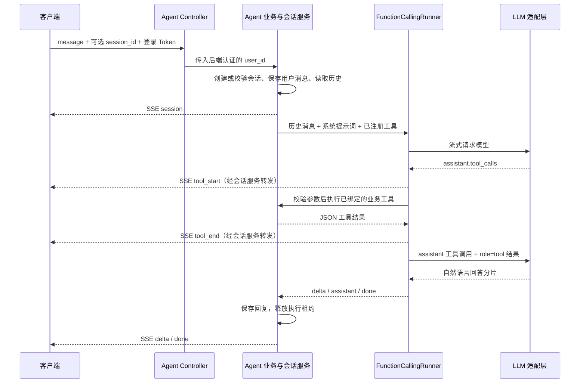

# Function Calling LLM / Agent 开发流程

[返回项目 README](../README.md)

本文以已实现的星座 Agent 为例，说明接口、模型、工具和业务服务如何协作，以及后续新增 Agent 的开发步骤。当前使用原生 Function Calling，尚未接入 LangChain、LangGraph 或 RAG；算命等其他 Agent 可沿用这套底座扩展。

## 1. 分层与代码入口

```text
app/
├── agents/                  # Agent 定义和公共编排运行器
│   ├── llm/                 # 模型厂商适配、统一消息和流式分片协议
│   └── astrology/           # 星座提示词、工具注册、运势内容生成
├── services/
│   └── agent/               # Agent 业务、数据库操作、会话和消息管理
├── api/
│   └── controllers/         # Agent HTTP 入口
├── schemas/
│   └── agent/               # 接口参数、工具参数、生成内容和 SSE 事件校验
├── models/                  # 用户档案、会话、消息、运势缓存表映射
└── constants/               # 消息状态等业务常量
```

| 入口 | 职责 |
|------|------|
| [agent_controller.py](../app/api/controllers/agent_controller.py) | 定义接口、注入登录用户、返回 SSE 响应 |
| [AstrologyService](../app/services/agent/astrology_service.py) | 绑定当前用户的工具，查询档案、读取和保存运势缓存 |
| [AgentChatService](../app/services/agent/chat_service.py) | 会话归属、历史上下文、执行租约、消息入库和异常收尾 |
| [星座 Agent 定义](../app/agents/astrology/agent.py) | 系统提示词、业务日期注入、工具声明和运行器创建 |
| [FunctionCallingRunner](../app/agents/runtime.py) | 拼接工具调用参数、校验、执行工具、多轮模型调用 |
| [运势内容生成](../app/agents/astrology/horoscope.py) | 缓存缺失时调用模型，生成并校验结构化娱乐内容 |
| [LLM 适配层](../app/agents/llm/base.py) | 用 `LLMAdapter`、`LLMMessage`、`LLMChunk` 隔离模型厂商 |
| [QwenLLM](../app/agents/llm/qwen.py) / [QwenAIService](../app/services/qwen_ai_service.py) | 前者转换 Agent 消息和分片，后者复用 HTTP 请求、后端密钥及错误处理 |

Controller 只负责入口。Agent 层管理提示词和编排，Service 层处理身份、数据和业务规则；模型不能直接操作数据库。

## 2. 一次对话如何执行



Function Calling 的含义是：模型提出函数名称和 JSON 参数，后端执行已注册的函数，再把结果交回模型。模型自身不执行 Python 函数。

运行器按以下步骤处理：

1. 将系统提示词、有效历史消息和本轮问题发送给模型，同时提供 `AgentTool.schema()` 生成的工具定义。
2. 模型可以直接回答，也可以返回一个或多个 `tool_calls`。流式参数可能分散在多个分片中，运行器收齐后再解析，不能收到一个片段就执行。
3. 按工具名称查找已注册的 handler，用对应 Pydantic Schema 校验参数，再按超时限制执行。当前工具依次执行。
4. 保存带 `tool_calls` 的 `assistant` 消息，再保存 `role="tool"` 的工具结果；结果的 `tool_call_id` 必须对应原调用 ID。
5. 将工具结果加入上下文，再次调用模型。模型可以继续调用工具，或输出最终回答；达到工具轮数上限后，最后一轮只允许总结。

工具执行失败会返回结构化错误，并发出 `tool_end.success=false`，模型仍可据此解释失败或在限额内修正参数。整轮执行异常才通过 SSE `error` 结束。

## 3. 星座查询与运势缓存

当前注册两个工具：

| 工具 | 模型可提交的参数 | 后端处理 |
|------|------------------|----------|
| `get_user_profile` | 无参数 | 读取当前登录用户的星座和出生档案 |
| `get_horoscope` | `constellation`、`fortune_date`、`aspect`，均可省略 | 查询指定星座、日期、领域的运势，无有效缓存时生成并保存 |

`constellation` 使用十二星座标准英文名，如 `pisces`；`aspect` 为 `all`、`love`、`career`、`wealth`。未指定星座时读取当前用户档案；档案也没有星座则请用户补充。未指定日期时，由后端按 `AGENT_TIMEZONE` 确定今天，每轮提示词也注入后端日期，避免模型猜测日期。

### 查询链路

```text
用户：双鱼座今天运势怎么样？
  → 编排模型识别意图，调用 get_horoscope
  → AstrologyService.get_horoscope
  → 按 星座 + 日期 + 领域 查询 MySQL horoscope_cache
      ├── 有效缓存：直接返回结构化内容
      └── 缺失或过期：
          释放读取事务 → generate_horoscope 调用模型生成 JSON
          → GeneratedHoroscope 校验 → 保存缓存 → 返回最终入库内容
  → 工具结果回给编排模型
  → 编排模型整理为自然语言，SSE 流式输出并保存聊天消息
```

这里有两种模型职责：**编排模型**负责理解问题、选择工具和解读结果；**内容生成模型**只在缓存缺失或过期时生成运势。两者目前都复用千问适配层，但调用相互独立。

生成阶段只传星座、日期、时区和领域，不传个人出生资料或聊天历史。内容必须包含五个非空字符串字段：`summary`、`love`、`career`、`wealth`、`advice`。生成不完整、字段非法或格式错误时，不写缓存。

### 缓存与来源约定

- 缓存是 MySQL 表 `horoscope_cache`，唯一键为 `constellation + fortune_date + aspect`。它与个人会话历史分开，同一星座、日期和领域可以跨用户复用。
- 当前生成内容标记 `source="ai_generated"`，附带“AI 生成的星座运势，仅供娱乐参考。”；`score` 保持空值。它属于 AI 创作，不代表第三方实时运势数据或专业星盘计算。
- 生成的缓存默认不设置 `expires_at`。日期变化会查询新的键；旧日期数据保留，不会在午夜自动删除。显式设置过期时间的记录会在查询时检查。
- 并发请求通过唯一键和写入规则保留有效结果，并重新读取最终入库内容；同时首次查询仍可能触发多次模型生成，目前没有合并生成请求的机制。
- 命中缓存会省略内容生成调用，编排模型仍需理解问题、调用工具并输出解读。

主 Agent 的 `AGENT_ENABLE_SEARCH` 允许模型使用千问搜索能力，但不会自动填充运势表。当前专用运势生成调用显式关闭搜索。后续接入第三方运势 API，可在 Service 中获取并校验数据，通过 `save_horoscope_cache` 保存真实来源，再继续复用现有工具和输出流程。

提示词调整位置：星座身份、工具使用和回答规则在 `agents/astrology/agent.py`；生成运势的 JSON 格式与内容要求在 `agents/astrology/horoscope.py`。

## 4. 接口与 SSE 协议

已实现接口：`POST /api/agent/astrology/stream`。使用项目登录 Token，通过 `Authorization: Bearer <token>` 传递身份。

| 请求字段 | 必填 | 说明 |
|----------|------|------|
| `message` | 是 | 1～4000 字符，不接受纯空白 |
| `session_id` | 否 | 已有会话 UUID；省略或传 `null` 创建新会话 |

请求不接受 `user_id`、模型、密钥或工具配置等额外字段。用户身份来自认证依赖，模型和工具由后端配置。每次省略 `session_id` 都会创建新会话，客户端需保存 `session` 事件返回的 ID 用于续聊。

新建对话：

```bash
curl -N -sS 'http://127.0.0.1:8001/api/agent/astrology/stream' \
  -H 'Authorization: Bearer <token>' \
  -H 'Content-Type: application/json' \
  -d '{"message":"帮我看看双鱼座今天的运势，包含感情、事业和财运。"}'
```

续聊时，将下面的 `session_id` 替换为实际返回值：

```json
{
  "message": "再详细说说事业方面。",
  "session_id": "11111111-1111-4111-8111-111111111111"
}
```

每个 SSE 数据块为 `data: {JSON}`，空行分隔；按 JSON 的 `type` 判断事件，不依赖命名 `event:`。

| `type` | 用途 |
|--------|------|
| `session` | 返回当前 `session_id` 和 `agent` 标识 |
| `tool_start` | 工具开始执行，包含 `tool_name`、`tool_call_id` |
| `tool_end` | 工具结束，包含调用标识和 `success` |
| `delta` | 回答文本片段，追加 `content`；`message_id` 标识对应消息 |
| `reasoning` | 协议预留的推理分片；当前千问 Agent 使用非思考模式 |
| `done` | 本轮正常结束，包含最终消息 ID 和编排运行器累计用量 |
| `error` | 流开始后的执行异常，`content` 为错误说明 |

以下为精简示例，ID 和内容仅用于说明：

```text
data: {"type":"session","session_id":"11111111-1111-4111-8111-111111111111","agent":"astrology"}

data: {"type":"tool_start","session_id":"11111111-1111-4111-8111-111111111111","agent":"astrology","tool_name":"get_horoscope","tool_call_id":"call_demo"}

data: {"type":"tool_end","session_id":"11111111-1111-4111-8111-111111111111","agent":"astrology","tool_name":"get_horoscope","tool_call_id":"call_demo","success":true}

data: {"type":"delta","session_id":"11111111-1111-4111-8111-111111111111","agent":"astrology","message_id":3,"content":"以下是双鱼座今日的生活参考，AI 生成，仅供娱乐参考。"}

data: {"type":"done","session_id":"11111111-1111-4111-8111-111111111111","agent":"astrology","message_id":3,"usage":{}}

```

知识问答可以不调用工具，工具也可能多轮调用，文本分片还可能出现在工具调用前。`tool_end.success=true` 表示函数执行成功，不等同于结果一定存在，例如档案查询可正常返回 `found=false`。工具原始 JSON 不直接作为 SSE 正文发给客户端，回答由模型结合工具结果生成。

`done.usage` 当前统计编排运行器各轮模型调用的整数用量字段，不包含工具内部独立生成运势的模型用量，不能直接作为整条链路的计费总量。

输入、认证、会话归属和会话占用等在首个事件前校验，失败沿用项目 JSON 错误响应；流开始后的异常使用 `error` 事件，此时不能再切换 HTTP 响应格式。客户端收到 `error` 后按失败结束，不要求后面一定有 `done`。

## 5. 会话、数据与配置

### 数据表

| 表 | 用途 |
|----|------|
| `users` | 复用现有用户，`id` 为整数，不另建 UUID 用户体系 |
| `user_astrology_profiles` | 每个用户一份星座和出生档案 |
| `chat_sessions` | UUID 会话，按 `user_id + agent` 校验归属，记录执行租约 |
| `chat_messages` | 保存用户、助手和工具消息，以及工具调用与结果关联 |
| `horoscope_cache` | 公共日运内容、来源及可选过期时间 |

`ChatMessageStatus` 定义在 [app/constants/astrology.py](../app/constants/astrology.py)：`0` 生成中、`1` 已完成、`2` 失败、`3` 中断。这是聊天消息状态，与图片和视频作品状态分开使用。

同一个会话同时只允许一个有效执行租约。进程异常导致租约过期后，新请求可恢复会话，并将遗留生成中消息标记为中断。历史重放保留有效工具调用组合并按配置裁剪；异常或断开连接时尝试保存已收到的部分文本并释放执行资源。数据库操作使用短事务，不在等待模型或工具网络请求时持有数据库事务。

部署前执行 `alembic upgrade head`。相关迁移包括 `20261111_0002` 的四张业务表和 `20261111_0003` 的会话执行字段。当前仅开放星座对话接口，档案更新、缓存维护等已有 Service 方法尚未单独开放 HTTP 接口。

### 后端配置

默认值维护在 [config/ai.py](../config/ai.py)，统一通过 `app.core.config.settings` 使用；密钥等环境信息在本地 `.env` 中维护，不传给前端。

| 配置 | 默认值 | 用途 |
|------|--------|------|
| `AGENT_LLM_PROVIDER` | `qwen` | 模型厂商适配器 |
| `AGENT_MODEL` | `qwen-plus` | Agent 模型，与普通聊天模型策略独立 |
| `AGENT_ENABLE_SEARCH` | `True` | 主 Agent 的千问联网搜索开关 |
| `AGENT_TIMEZONE` | `Asia/Shanghai` | 当前业务日期 |
| `AGENT_MAX_TOOL_ROUNDS` | `4` | 最大工具调用轮数，其后仅总结 |
| `AGENT_MAX_TOOL_CALLS` | `4` | 每轮工具调用数量限制 |
| `AGENT_MAX_HISTORY_MESSAGES` | `60` | 历史读取消息数量上限 |
| `AGENT_MAX_HISTORY_CHARS` | `24000` | 历史上下文字数上限 |
| `AGENT_TOOL_TIMEOUT` | `30.0` 秒 | 单次工具执行及运势生成超时 |
| `AGENT_RUN_TIMEOUT` | `300.0` 秒 | 整轮执行超时 |

Agent 复用已有 `QWEN_API_KEY` 和 `QWEN_CHAT_URL`，鉴权、请求发送及 HTTP 错误处理集中在 `QwenAIService`。已有普通聊天、多模态流式转发和 TTS 接口继续使用各自协议与业务服务，Agent 接口使用本页定义的事件协议。

## 6. 新增工具或 Agent 的开发步骤

### 给现有 Agent 增加工具

1. 在 `app/schemas/agent/` 定义参数 Schema，使用 `extra="forbid"` 和字段约束。参数只描述业务输入，用户身份从后端认证上下文取得。
2. 在 `app/services/agent/` 实现业务方法，负责归属检查、查询、业务规则和结构化返回值；新增表时补充 Model、导出注册和 Alembic 迁移。
3. 参考 `AstrologyService._chat_service` 创建 handler，在闭包中绑定当前 `user_id`，通过会话工厂取得工具自己的数据库会话。
4. 在 Agent 工厂的 `tools` 中增加 `AgentTool(name, description, parameters, handler)`，并在系统提示词中说明调用条件与结果解释规则。
5. 复用 `FunctionCallingRunner` 的参数校验、超时、错误结果、消息关联和 SSE 转换，无需为每个工具另写模型 HTTP 请求。

现有运势工具的注册方式：

```python
AgentTool(
    name="get_horoscope",
    description="获取指定星座、日期、领域的运势；优先读缓存，无缓存时生成 AI 娱乐参考。",
    parameters=HoroscopeToolRequest,
    handler=horoscope_handler,
)
```

其中 `horoscope_handler` 由业务 Service 绑定真实用户，运行器只向它传递通过 Schema 校验的业务参数。工具结果应是可 JSON 序列化的数据，日期、Decimal 等由 Service 转为适合返回的类型。

### 新增一个业务 Agent

1. 在 `app/agents/<业务名>/` 新建定义，维护该 Agent 的提示词和工具集合，为运行器设置独立 `name`。
2. 在 `app/services/agent/` 新建业务服务，绑定该业务的工具，复用 `AgentChatService` 管理会话和消息。
3. 在 `app/api/controllers/agent_controller.py` 增加对应路由，继续只做参数、身份和响应转发。例如未来可增加 `/api/agent/divination/stream`，当前尚未实现。
4. 请求兼容时继续使用 `AgentChatRequest` 和 `AgentStreamEvent`；新增业务参数放到该 Agent 的 Schema 中校验。会话必须继续按用户和 Agent 标识隔离。
5. 验证新建与续聊、工具参数错误、缓存命中与缺失、跨用户访问、并发执行和客户端断开等实际场景。

### 新增模型厂商或替换编排框架

新增厂商在 `app/agents/llm/` 实现 `LLMAdapter.stream(messages, tools)`，输出统一的 `LLMChunk`，再更新 `create_llm` 工厂和后端配置。适配器需完整保留工具参数分片、结束原因和用量，不能只转发文本。

后续采用 LangChain / LangGraph 时，可实现兼容 `AgentRunner` 的运行器，提供 `name` 和 `run(history)`，输出现有 `AgentStep` 生命周期事件。这样可继续复用业务工具、会话存储和 HTTP/SSE 协议；具体框架的工具与消息格式由新运行器转换，目前项目没有这部分实现。
