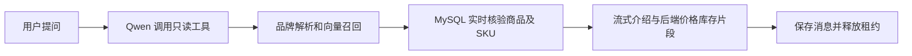

# 商品查询 Agent

沿用星座 Agent 的 LLM、Function Calling、用户认证、会话存储及 SSE，增加商品专属提示词、只读工具和 Chroma 语义召回。当前只查询商品，不提供商品新增、编辑或删除接口。

## 目录与职责

| 目录 / 模块 | 职责 |
| --- | --- |
| `app/api/controllers/agent_controller.py` | 接收请求、注入用户和共享服务、返回 SSE |
| `app/agents/goods/` | 商品提示词、工具注册、两阶段输出和历史事实隔离 |
| `app/agents/llm/` | 复用 Qwen 对话适配器；新增可替换的 Embedding 适配器 |
| `app/services/agent/goods_service.py` | 品牌解析、语义召回、实时回查及内部索引维护 |
| `app/services/agent/goods_data_service.py` | 商品、类目、品牌、SKU 的只读 SQL 和数据组装 |
| `app/services/agent/goods_vector_service.py` | PersistentClient、索引发布、Top-K、品牌过滤和距离阈值 |
| `app/models/goods.py` | 严格映射现有商品四表 |
| `app/setup/agents.py` | 应用共享实例的后台初始化及关闭 |

## 数据约定

读取 `sql/code-product.sql` 中的 `goods_categories`、`goods_brands`、`goods_products`、`goods_skus`。SPU 通过 `brand_id`、`category_id` 关联品牌及类目，SKU 通过 `product_id` 关联商品。四表的创建、更新时间由 MySQL 维护。

`goods_products.spec_type=1` 为单规格，`2` 为多规格，以商品字段为准。样例为 10 类目、20 品牌、50 SPU、65 SKU，其中 36 个单规格、14 个多规格商品。品牌关联按原需求随机分配，不代表真实品牌；查询严格使用数据库关系，不自动按商品名称纠正品牌。

会话继续使用 `chat_sessions` 和 `chat_messages`，标记 `agent=goods`，不另建聊天表，不允许跨用户或跨 Agent 访问。

## 查询链路



开放工具只有两个：

- `tool_semantic_product_search(query, brand=None)`：按需求召回，明确品牌时精确过滤；未知、歧义品牌要求确认，不静默放宽条件。
- `tool_check_sku_stock_and_price(product_id)`：按商品 ID 查询当前在售规格、价格和库存，每次追问重新查询。

向量文档包含商品名称、品牌、类目路径和描述；元数据仅存 `product_id`、`brand_id`、`category_id`，稳定文档 ID 为 `prod_{product_id}`，不存价格和库存。使用余弦距离，越小越相似；默认召回 10 个候选，经 MySQL 核验后最多返回 3 个。

MySQL 再次过滤上架状态与 SKU 在售状态，按召回顺序返回商品。保留零库存规格，全部零库存显示缺货；无在售规格单独区分，不作为搜索推荐。售价以 Decimal 序列化为两位小数。品牌、索引批次及详情查询使用独立短会话，远程向量请求期间不占用商品查询事务。

## 工具循环与输出

复用公共 `FunctionCallingRunner`、`AgentChatService` 和 `SSEUtil`。商品 Agent 关闭联网搜索，仅以平台数据库作为商品事实来源。

1. 决策阶段沿用流式模型调用，但隐藏文字与推理，只公开工具开始、结束事件。完整工具调用和结果照常存库。
2. 有效查询后，再使用同一运行器进行无工具的流式总结。常见单工具查询包含工具决策、决策终止、最终总结共 3 次模型请求；多轮查询可能更多。
3. 总结模型只接收本轮商品介绍资料。后端固定追加查询时刻的 SKU、售价、库存和时间；模型自然语言介绍仍需持续评估，不能据此宣称绝无幻觉。
4. 无有效事实、品牌歧义、无匹配、下架或工具异常时使用明确的后端答复，禁止补造价格库存。
5. 模型历史仅保留用户消息及旧商品 ID/名称定位摘要，旧价格和助手回答不作为当前事实。数据库保留原始消息。
6. 后续工具失败、下架或空结果会作废早期事实。工具白名单、参数、结果体积和超时沿用公共限制。

## 接口

`POST /api/agent/goods/stream`，携带已有登录 Token：

```bash
curl -N -sS 'http://127.0.0.1:8001/api/agent/goods/stream' \
  -H 'Authorization: Bearer <登录返回的token>' \
  -H 'Content-Type: application/json' \
  -d '{"message":"帮我找适合出差用的降噪耳机。"}'
```

续聊增加首个 `session` 事件返回的 UUID：

```json
{"message":"商品 ID 9 现在多少钱，还有哪些规格？","session_id":"首个事件返回的会话UUID"}
```

沿用 `session`、`tool_start`、`tool_end`、`delta`、`done`、`error` 事件，`delta.content` 为回答分片。商品流新增通用 `data` 事件，在本轮全部工具查询结束、文字介绍开始前返回一次最终商品列表。前端不传用户 ID、模型、API Key 或索引维护参数。

```json
{"type":"data","session_id":"会话UUID","agent":"goods","message_id":30,"data":{"kind":"products","products":[{"product_id":9,"name":"降噪耳机","cover_image":"https://example.com/headphones.jpg","brand_id":15,"brand_name":"索尼","category_id":6,"category_name":"音频设备","description":"主动降噪，适合差旅。","spec_type":2,"availability":"in_stock","queried_at":"2026-11-12T18:30:00+08:00","skus":[{"sku_id":18,"sku_code":"SKU-XM5-BLK","spec_name":"黑色 / 标准版","price":"2299.00","stock":35}]}]}}
```

前端识别 `type=data` 且 `data.kind=products` 后，使用 `data.products` 渲染封面与商品卡片，继续拼接 `delta.content` 展示文字。封面直接来自 MySQL 的 `cover_image`，数据库为空时返回空字符串，可由前端展示占位图；无有效商品时仍发送 `products: []`，用于清除上一轮卡片。此数据由后端查询结果生成，不依赖模型输出图片地址；原工具结果仍按已有机制存入消息表。

## 配置与部署

安装项目依赖后使用 `chromadb==1.5.9`，无需独立 Chroma 服务，也不下载其默认向量模型。Embedding 复用后端 `.env` 的 `QWEN_API_KEY` 和公共 `QwenAIService` 请求。

- `config/ai.py`：Embedding 地址、模型、维度、超时，默认 `text-embedding-v4`、1024 维，每批最多 10 条，查询与建库保持一致。接口约束见 [阿里云 Embedding 文档](https://www.alibabacloud.com/help/en/model-studio/embedding-interfaces-compatible-with-openai)。
- `config/goods.py`：功能开关、索引路径、集合、批量大小、Top-K、返回数量和距离阈值。默认阈值 `0.65` 需按实际数据校准。

部署时先运行 `alembic upgrade head`，迁移 `20261112_0001` 会创建缺失的四张商品表及索引，已有表和数据保持原样；仅创建结构，不插入商品。价格仍由 SKU 提供，不增加 SPU 价格或最低价字段。应用不自动导入样例 SQL；**样例 SQL 含 DROP TABLE，不能直接对已有业务库执行**。启动后后台初始化索引，失败不阻断星座等模块。冷启动查询可能等待初始化，超出工具预算会提示重试；建议索引就绪后测试商品搜索。`GOODS_AGENT_ENABLED=False` 可关闭商品模块。

本地目录默认 `./data/chroma_db`，Docker Compose 已挂载宿主机目录，索引不进入 Git 或镜像构建上下文。**同一路径只运行一个应用进程 / 一个维护实例**；多 worker 或多副本需独立索引目录，或后续接入服务端向量库。

## 索引复用及内部维护

每代 Collection 使用配置名称前缀附加 generation。全部导入并校验数量后才标记就绪，重启仅加载模型、维度、距离度量、文档版本匹配的完整代。失败或取消的半成品不会被复用；完整空索引可以复用，之后新增资料需显式同步。

共享 `GoodsService` 提供内部方法，不开放给前端或 LLM：

- `refresh_index(product_ids)`：读取当前资料，upsert 上架商品，删除不存在或已下架商品的向量。
- `rebuild_index()`：完整重建。
- 向量服务 `upsert(documents)` / `delete(product_ids)`：只维护向量，不修改 MySQL。

更新时复制原向量到新代，成功后发布，失败保留旧完整代；复制已有商品不会再次请求 Embedding。此方案适合当前规模，应批量传入变动 ID。旧代在下次首次连接时清理，保留最近两代完整索引，运行期间需关注磁盘空间。

当前不自动轮询 MySQL，也不进行变更捕获。商品名称、描述、品牌或类目变更后需显式同步；品牌/类目更新应包含关联商品，不能只看 SPU 的 `updated_at`。价格和库存变化无须重建向量，下次直接回查 MySQL。

## 本次验证记录

2026-11-12 已完成以下验证：

- 真实 MySQL 临时库验证 50 商品、65 SKU、品牌过滤、分页、上下架、停售规格、缺 SKU、零库存及价格刷新，结束后删除临时库。
- Chroma 临时持久化验证初始化、重启复用、品牌过滤、距离阈值、重建、同步失败及取消后保留完整索引；Embedding 参数和结果校验另做离线验证。
- 模型替身验证工具循环、历史事实清理、跨用户/跨 Agent 隔离、消息保存、异常与中断收尾；使用真实 MySQL 和 Chroma 验证 HTTP SSE 集成。
- 商品 SQL 导入后，8001 服务真实登录与商品查询通过：返回 3 款耳机、52 个回答分片，价格库存与工具结果一致，正常结束且租约释放。只清理本次创建的测试账号及会话，未修改商品记录。

真实语义抽查能召回降噪耳机和跑步鞋，但鞋类近邻中也出现篮球鞋；这不等于所有结果都完全符合用途，仍需持续评估商品描述及相关性阈值。当前验证使用真实 Qwen，未将模型替身结果冒充真实模型验收。
